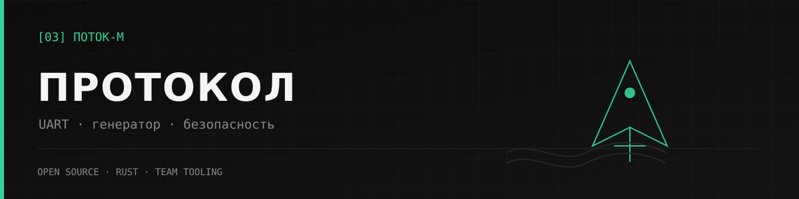
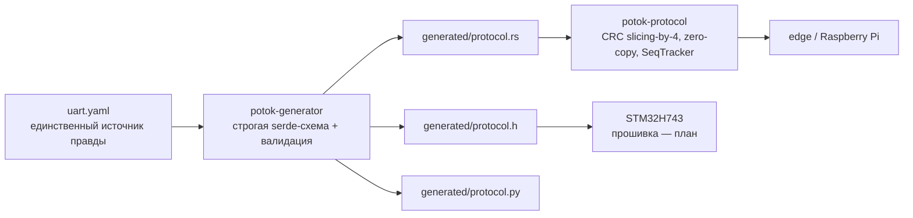

[](https://github.com/rocket-team-m/potok-m-protocol/actions/workflows/ci.yml)

# Поток-М: UART-протокол

Описание кадров и генератор биндингов для обмена между STM32H743 и бортовым компьютером системы стабилизации «Поток-М». Запрос с датчиков идёт **STM32 → Pi**, ответ с поправками и состоянием ИИ — **Pi → STM32**.

> Единственный источник правды — `uart.yaml`. Всё в `generated/` выводится из него и перезаписывается при генерации. Прошивки STM32 в репозитории нет — только план.

## Ссылки

- [uart.yaml](uart.yaml) — профили, кадры, CRC, фазы, флаги
- [BUILD_LOG.md](BUILD_LOG.md) — golden-байты и замеры hotpath
- [potok-m-ai](https://github.com/rocket-team-m/potok-m-ai) — потребитель кадров на стороне Pi
- [potok-m-sim](https://github.com/rocket-team-m/potok-m-sim) — генератор кадров в симуляции
- [План прошивки](https://github.com/rocket-team-m/potok-m/blob/main/FIRMWARE_RUST_PLAN.md)

## Архитектура



Генератор читает только YAML и порождает три биндинга. Схема строгая (`deny_unknown_fields`): лишний или опечатанный ключ — ошибка; валидация сверяет размер кадра с суммой полей, положение CRC, версии, magic и ссылки на enum/флаги. Сгенерированные файлы детерминированы и зафиксированы в git — потребителям генератор не нужен, достаточно `--check`.

CRC-16/CCITT-FALSE (полином `0x1021`, init `0xFFFF`, без отражения и финального XOR) покрывает все байты кадра, кроме последних двух; таблица с slicing-by-4 убирает последовательную зависимость. Декодирование zero-copy, без выделений в горящем цикле. `SeqTracker` считает номер кадра по кругу и отвергает дубли и запоздавшие кадры.

## Профили

| | `compat` (по умолчанию) | `lowlat` |
| --- | --- | --- |
| Запрос STM32 → Pi | 56 Б, magic `0x504D`, `f32` + `i16` | 42 Б, magic `0x4C54`, 14 × `int16` |
| Ответ Pi → STM32 | 14 Б, magic `0x5250` | 16 Б, magic `0x4C52`, поле `compute_us` |
| Скорость | 921600 бод, 8N1 | 2 Мбит/с, 8N1 |
| Версия кадров | 1 | 1 |

Фазы общие для профилей: `BURN=0`, `COAST=1`, `APOGEE=2`, `DESCENT=3`, `LANDED=4`. Фазу выставляет STM32; Pi не может переопределить `BURN` и не управляет сервами напрямую. Три подряд отвергнутых кадра отключают ассистента до конца полёта; снимает только явный сброс прошивки. Повторной передачи нет — пропуск по дедлайну считается отказом кадра. CRC не криптозащита: он ловит случайные искажения, не злонамеренные атаки.

## Быстрый старт

```bash
cargo check -p potok-protocol --no-default-features   # no_std, без аллокатора
cargo test                                             # 36 тестов
cargo run -p potok-generator -- --check                # файлы совпадают с YAML
cargo run --release -p potok-protocol --example hotpath 1000000
```

Библиотека `potok-protocol` не имеет зависимостей, `no_std` по умолчанию (фича `std` добавляет `impl std::error::Error`). Для C достаточно header-only `generated/protocol.h` (C11, явная укладка байтов, без `memcpy` структуры); для Python — `generated/protocol.py`. Все три языка воспроизводят одни и те же golden-кадры — это зафиксировано тестами.

## Структура

| Путь | Содержание |
| --- | --- |
| `uart.yaml` | Профили, кадры, CRC, фазы, флаги, версии, magic — источник правды |
| `generator/` | Строгая serde-схема, валидация, генераторы `.rs` / `.h` / `.py` |
| `generated/` | Зафиксированные в git детерминированные артефакты |
| `potok-protocol/` | CRC slicing-by-4, codec, zero-copy `RequestView`/`ReplyView`, `SeqTracker`, помощники для флагов и углов |
| `BUILD_LOG.md` | Протокол проверок, golden-байты, замеры |

## Статус и ограничения

- **Прошивки нет.** Есть только план `FIRMWARE_RUST_PLAN.md` в корне `potok-m`: STM32H743, Embassy, `defmt` поверх RTT, `probe-rs`, без аллокатора, две задачи — UART (DMA, двойной буфер, кадрирование по magic) и управление (seq, счётчики пропусков, защёлка ИИ, фаза, watchdog). Каталога `firmware/` не существует.
- **Замеров на реальной STM32 нет.** Время в проводе — расчёт из размера кадра и скорости, а не измерение. Замер на edge для `lowlat`: полный цикл p50 40,6 мкс, p99 356,6 мкс; с проводами 588,6 мкс; худший цикл с учителем 1,18 мс из отведённых 10 мс.
- **Не закрыто:** проверка на помехи, fault injection на линии, проверка `BURN` с подключёнными сервами, кросс-языковая интероперабельность с прошивкой и формальный safety case.
- **Бюджет МКУ — расчёт:** 70 Б RAM под два статических буфера и 1536 Б Flash под таблицы CRC.

## Лицензия

MIT.
